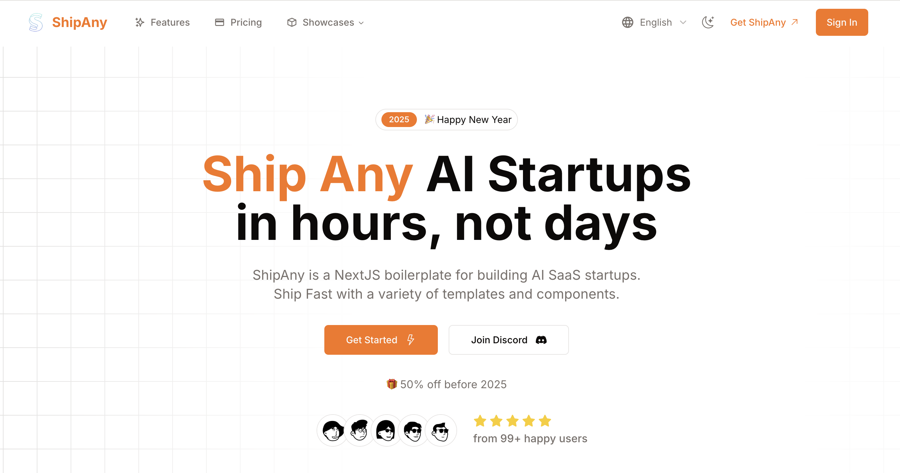

# TurboLearn Template One

Ship Any AI SaaS Startups in hours.



## Quick Start

1. Clone the repository

```bash
git clone https://github.com/turbolearnai/turbolearn-template-one.git
```

2. Install dependencies

```bash
pnpm install
```

3. Run the development server

```bash
pnpm dev
```

## Customize

- Set your environment variables

```bash
cp .env.example .env.local
```

- Set your theme in `app/theme.css`

[shadcn-ui-theme-generator](https://zippystarter.com/tools/shadcn-ui-theme-generator)

- Set your landing page content in `i18n/pages/landing`

- Set your i18n messages in `i18n/messages`

## Deploy

- Deploy to Vercel

[](https://vercel.com/new/clone?repository-url=https%3A%2F%2Fgithub.com%2Fturbolearnai%2Fturbolearn-template-one&project-name=my-turbolearn-project&repository-name=my-turbolearn-project&redirect-url=https%3A%2F%2Fturbolearn.ai&demo-title=TurboLearn&demo-description=AI-Powered%20Learning%20Platform%20for%20smarter%20studying&demo-url=https%3A%2F%2Fturbolearn.ai&demo-image=https%3A%2F%2Fpbs.twimg.com%2Fmedia%2FGgGSW3La8AAGJgU%3Fformat%3Djpg%26name%3Dlarge)

- Deploy to Cloudflare

1. Customize your environment variables

```bash
cp .env.example .env.production
cp wrangler.toml.example wrangler.toml
```

edit your environment variables in `.env.production`

and put all the environment variables under `[vars]` in `wrangler.toml`

2. Deploy

```bash
npm run cf:deploy
```

## Community

- [TurboLearn](https://turbolearn.ai)
- [Documentation](https://docs.turbolearn.ai)
- [Discord](https://discord.gg/HQNnrzjZQS)

## License

- [TurboLearn AI Learning Platform License Agreement](LICENSE)
