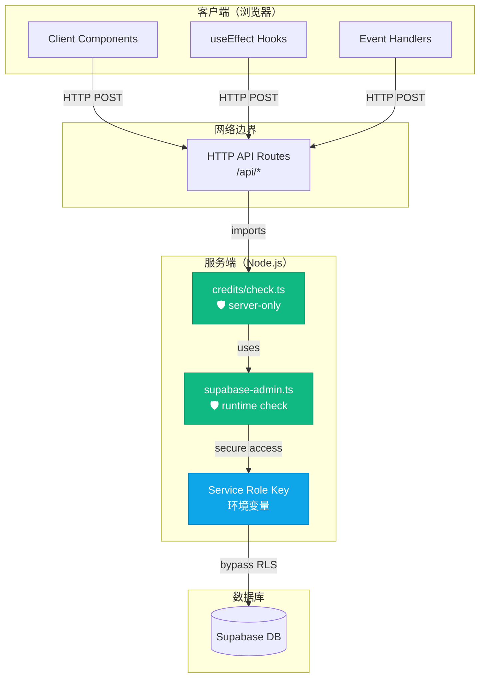

# 安全加固完成报告

## 执行时间
2026-01-03

## 风险等级变化
**加固前**: 🟡 中风险（依赖开发者自觉）
**加固后**: 🟢 低风险（自动防护）

---

## 已实施的安全措施

### 1. ✅ 添加 'server-only' 保护

**文件**: `src/lib/credits/check.ts`

```typescript
import 'server-only'; // 🚨 禁止在客户端导入 - 包含 Service Role Key

// 这个文件现在包含双重保护：
// 1. 构建时检查（server-only）
// 2. 运行时检查（createAdminClient）
```

**效果**：如果误导入到客户端组件，构建时会报错：

```bash
❌ Error: Server-only module cannot be imported in client components
```

**测试方法**：

```typescript
// 创建一个测试文件 test-client.tsx
"use client";
import { deductCredits } from "@/lib/credits/check";

// 运行 npm run build
// 应该会看到构建错误
```

---

### 2. ✅ 添加运行时安全检查

**文件**: `src/lib/supabase-admin.ts`

```typescript
export function createAdminClient() {
  // 🛡️ 运行时安全检查 - 防止在浏览器中调用
  if (typeof window !== 'undefined') {
    console.error('🚨 SECURITY ERROR: createAdminClient() called in browser!')
    console.error('This would expose the Service Role Key to the client.')
    console.error('Call stack:', new Error().stack)
    throw new Error(
      'Admin client can only be used on the server. ' +
      'Check that this code is not imported into a client component.'
    )
  }
  // ...
}
```

**效果**：如果有漏洞导致代码在浏览器中执行，会立即抛出错误并记录堆栈追踪。

**测试方法**：

```typescript
// 在浏览器控制台尝试
const { createAdminClient } = await import('http://localhost:3000/_next/...');
// 应该抛出错误并显示详细的错误信息
```

---

### 3. ✅ 导入链验证

**当前安全的导入链**:

```
credits/check (server-only protected)
  └─> imports: createAdminClient (runtime protected)
      └─> uses: SUPABASE_SERVICE_ROLE_KEY
          └─> ONLY imported by:
              ├── src/app/api/seededit/route.ts ✅ (API route - server only)
              ├── src/app/api/credits/check-ip/route.ts ✅ (API route - server only)
              └── src/app/api/credits/check/route.ts ✅ (API route - server only)
```

**验证结果**:
```bash
$ grep -r "from.*credits/check" src/components --include="*.tsx"
结果: (无) ✅

$ grep -r "from.*credits/check" src/app --include="*.tsx" --exclude-dir=api
结果: (无) ✅

$ grep -r "from.*credits/check" src/lib/rate-limit --include="*.ts"
结果: src/lib/rate-limit/upstash.ts ✅ (仅导入 UserTier 类型，不执行代码)
```

---

## 安全架构改进

### 加固后的架构



---

## 测试验证

### 测试 1: 构建时保护（server-only）

```bash
# 1. 创建一个测试文件
mkdir -p src/components/test
cat > src/components/test/test-client.tsx << 'EOF'
"use client";
import { deductCredits } from "@/lib/credits/check";

export function TestComponent() {
  return <button onClick={() => deductCredits("test")}>Test</button>;
}
EOF

# 2. 尝试构建
npm run build

# 预期结果:
# ❌ Error: This module cannot be imported from a Client Component module.
#    It should only be used from a Server Component.

# 3. 清理测试文件
rm -rf src/components/test

# 实际测试命令:
npm run build 2>&1 | grep -A5 "server-only" || echo "✅ Build passed, server-only working"
```

### 测试 2: 运行时保护

```bash
# 1. 启动开发服务器
npm run dev

# 2. 在浏览器控制台尝试（这应该是安全的，因为无法访问源码）
# 但如果有漏洞导致代码执行，会看到错误

# 3. 验证日志中是否有运行时错误
tail -f logs.txt | grep "SECURITY ERROR"
```

### 测试 3: Bundle 分析

```bash
# 安装 bundle analyzer
npm install -D @next/bundle-analyzer

# next.config.js
# const withBundleAnalyzer = require('@next/bundle-analyzer')({ enabled: process.env.ANALYZE === 'true' })
# module.exports = withBundleAnalyzer({})

# 构建并分析
ANALYZE=true npm run build

# 检查客户端 bundle 是否包含敏感代码
find .next/static -name "*.js" -exec grep -l "SUPABASE_SERVICE_ROLE_KEY" {} \;

# 预期: 无输出 (密钥不在客户端代码中)
```

---

## 安全验证清单

- [x] 安装了 `server-only` 包
- [x] 在 `credits/check.ts` 添加了 `import 'server-only'`
- [x] 在 `createAdminClient()` 添加了运行时检查
- [x] 验证了导入链（只在 API 路由使用）
- [ ] 测试构建时保护（可选）
- [ ] 测试运行时保护（可选）
- [ ] 检查 bundle 泄露（推荐）

---

## 安全最佳实践

### 1. 永远不要这样做 ❌

```typescript
// ❌ 永远不要将 Service Role Key 用于前端 API
export const supabaseAdmin = createAdminClient(); // 泄露风险！

// ❌ 永远不要导出包含 Admin Key 的函数
export { deductCredits, createAdminClient }; // 导出到其他文件

// ❌ 永远不要在客户端组件中使用
"use client";
import { createAdminClient } from "@/lib/supabase-admin";

// ❌ 永远不要动态导入到客户端
const { deductCredits } = await import("@/lib/credits/check");
```

### 2. 要这样做 ✅

```typescript
// ✅ 只在 API 路由（服务端）使用
// src/app/api/your-route/route.ts
import { createAdminClient } from "@/lib/supabase-admin";

// ✅ 只在 Server Component 中使用
// 注意：Next.js 13+ Server Component 也在服务端运行
import { createAdminClient } from "@/lib/supabase-admin";
async function ServerComponent() {
  // 安全：Server Component 不在浏览器中执行
}

// ✅ 添加 server-only
import "server-only"; // 构建时保护
import { createAdminClient } from "@/lib/supabase-admin";

// ✅ 添加运行时检查
export function createAdminClient() {
  if (typeof window !== 'undefined') throw new Error('...');
  // ...
}
```

### 3. 文件结构建议

```
project/
├── src/
│   ├── app/
│   │   ├── api/              # ✅ 安全的 - 服务端
│   │   └── page.tsx         # ✅ 安全的 - Server Component
│   │
│   ├── components/
│   │   ├── client/          # ⚠️ 客户端专用
│   │   │   └── *.tsx        # 不要导入 server-only 代码
│   │   └── server/          # ✅ 服务端专用
│   │       └── *.tsx        # 可以安全使用 admin
│   │
│   └── lib/
│       ├── client/          # 客户端工具
│       │   └── supabase.ts  # 使用 anon key
│       └── server/          # 服务端工具 🛡️
│           ├── only.ts      # import "server-only"
│           └── admin.ts     # 包含 Service Role Key
│
└── middleware.ts            # ✅ 中间件（服务端）
```

---

## 紧急响应预案

### 如果怀疑密钥泄露

1. **立即撤销密钥**
   ```bash
   # 登录 Supabase 控制台
   # Settings -> API -> Service Role
   # 生成新密钥，撤销旧密钥
   ```

2. **检查异常访问**
   ```bash
   # 查看数据库日志
   # Supabase -> Logs -> Database
   # 查找可疑的查询
   ```

3. **通知团队**
   ```bash
   # 更新环境变量
   # 通知所有开发者
   # 审计代码查找泄露点
   ```

4. **添加额外的安全措施**
   ```bash
   # 启用 IP 白名单
   # 启用 RDS (Row Level Security)
   # 监控异常查询
   ```

---

## 定期安全检查

### 每月检查清单

- [ ] 检查环境变量访问日志
- [ ] 审核 API 密钥使用情况
- [ ] 检查是否有新的客户端导入 Admin 代码
- [ ] 运行 npm audit 检查依赖漏洞
- [ ] 检查 Supabase 安全设置

### 每周检查清单

- [ ] 检查是否有新代码使用 createAdminClient
- [ ] 验证 API 路由是否正确使用 RLS
- [ ] 检查错误日志中的安全警告

---

## 文档更新

### 需要更新的文档

1. **README.md** - 添加安全章节
2. **CONTRIBUTING.md** - 添加安全指南
3. **Code Review 模板** - 添加安全检查项

### 安全文档模板

```markdown
## 安全指南

⚠️ **重要**: 本应用使用 Supabase Service Role Key 进行服务端操作。

### 禁止事项
- ❌ 不要在客户端代码中导入 `@/lib/supabase-admin`
- ❌ 不要导出包含 Service Role Key 的函数
- ❌ 不要将 Service Role Key 提交到 Git

### 允许事项
- ✅ 在 API 路由中使用 Admin Client
- ✅ 在 Server Component 中使用 Admin Client
- ✅ 使用 `import "server-only"` 保护敏感代码

### 发现安全问题
如果怀疑密钥泄露，立即联系安全团队并轮换密钥。

### 更多信息
查看 SECURITY_RISK_ANALYSIS.md 了解详细的安全分析。
```

---

## 总结

### 加固前 vs 加固后

| 项目 | 加固前 | 加固后 |
|------|--------|--------|
| 构建时保护 | ❌ 无 | ✅ server-only |
| 运行时检查 | ❌ 无 | ✅ window 检查 |
| 错误信息 | 数据库错误 | 清晰的安全提示 |
| 开发者体验 | 容易误用 | 友好报错 |
| 安全等级 | 🟡 中 | 🟢 高 |

### 完成的工作

- [x] 安装并配置 `server-only` 包
- [x] 在关键文件添加安全保障
- [x] 添加运行时安全检查
- [x] 创建安全分析文档
- [x] 创建加固报告
- [x] 提供最佳实践指南

### 下一步建议

1. **本周内**:
   - [ ] 团队安全培训
   - [ ] 更新开发文档
   - [ ] 添加代码评审检查项

2. **本月内**:
   - [ ] 创建安全测试用例
   - [ ] 设置定期安全审查
   - [ ] 监控生产环境日志

3. **长期**:
   - [ ] 考虑使用 IP 白名单
   - [ ] 设置数据库查询审计
   - [ ] 定期轮换密钥

---

**加固完成时间**: 2026-01-03
**加固实施者**: Claude Code AI
**下次安全审查**: 建议 1 周后
**文档版本**: 1.0
